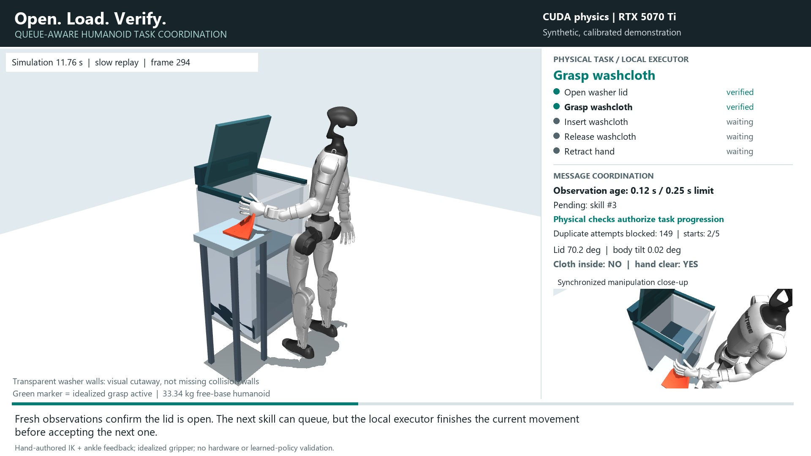

# Humanoid Laundry Queues

**Open the washer. Load a washcloth. Verify completion despite missing receipts.**
A standalone, simulation-only demonstration of queue-aware task coordination
above an articulated humanoid controller. This repository is separate from the
original [Assured Autonomy research](https://github.com/rbajaj5/delay-aware-runtime-assurance-lab)
and [RAG](https://github.com/rbajaj5/assured-autonomy-rag).

[](https://github.com/rbajaj5/humanoid-laundry-queues/releases/download/laundry-task-2026-10-24/humanoid_laundry_task_narrated.mp4)

**[Watch / download the new narrated MP4 (66 seconds, 1080p)](https://github.com/rbajaj5/humanoid-laundry-queues/releases/download/laundry-task-2026-10-24/humanoid_laundry_task_narrated.mp4)**
Visible captions, a synchronized manipulation close-up, task state and message
telemetry all come from the retained simulation. One demonstration, not a gallery
of repeated clips. The play link opens the MP4; GitHub README playback varies by client.

## What Actually Moves

- A **33.341 kg Unitree G1**, 29 actuators and a freely moving base, with the
  pinned model's link masses, inertias, gravity, contact and actuator limits.
- A **passive hinged washer lid**, opened by the right hand. No motor drives the
  lid and no script sets its angle during integration.
- A **55 g deformable washcloth**, picked up with the left hand, inserted,
  released and retained inside the washer after hand retraction.
- Joint targets come from hand-authored whole-body inverse kinematics plus
  simple ankle feedback. The pelvis is not welded or externally stabilized.

**Physics runs on the NVIDIA RTX 5070 Ti Laptop GPU using MuJoCo Warp**, at 2 ms
steps. CPU code handles IK, protocol logic and kinematic readback. The movie is a
replay of GPU-integrated states, not generative video. Graphics and encoding are
separate: the recorded renderer is identified in
[render provenance](laundry_task/output/task_render_provenance.json).

## Where Queue Awareness Matters

The useful distinction is between **issued, received, executing and physically
completed**, not arbitrary delays inside every joint.

1. The opening receipt is withheld, while the physical action continues.
2. Retries preserve the command ID. The receiver blocks duplicate execution.
3. Observations have a 250 ms freshness limit; a 1.2 s observation blackout
   causes stale/repeated observations to be rejected.
4. Fresh physical postconditions authorize progression. A receipt alone never
   establishes success, and a timeout never means that an action was canceled.
5. The receiver checks current preconditions and finishes an active movement
   before accepting a conflicting next skill. Release requires the cloth inside.

The experiment uses one robot, one washer session and an in-memory ledger. This
is not distributed consensus or crash-safe exactly-once physical execution.

## Measured Result

Both retained final runs use the same frozen body controller, model, starting
state and skill sequence. They differ in observation/receipt scheduling, not in
joint dynamics. No stochastic noise is injected, so there is no random seed.

| CUDA episode | Completed skills | Finish time | Post-finish cloth retention | Duplicate attempts blocked |
| --- | ---: | ---: | ---: | ---: |
| Timely observation / receipt reference | 5 / 5 | 23.56 s | 3.00 s | 285 |
| Delayed observations; opening receipt missing | 5 / 5 | 23.56 s | 3.00 s | 270 |

The stress run also rejected 30 repeated/stale observation updates. Only five
physical skills started. The duplicate count measures repeated message attempts,
**not prevented accidents**. This deliberately simple protocol retries at each
eligible control tick after its 0.5 s timeout, even after receipt but before
physical verification; the blackout suppresses some retries. A backoff policy
would reduce traffic. The reference still has 120 ms command transport delay.

Maximum body tilt was about **1.735 degrees** in both runs. The lid reached about
70.25 degrees. Task success requires all 16 cloth vertices within the defined
retention region for three seconds after the executor finishes retraction,
with no active grasp and the hands clear. Checks are sampled at 40 ms; they are
not a continuous-time safety proof.

**This is a calibrated feasibility demonstration, not evidence of superiority
over a delay-blind controller or an estimate of robot reliability.** Both runs use
the queue-aware supervisor. No trained laundry policy or hardware is evaluated.

## Evidence and Reproduction

- [Stress run: configuration, every observation and event](laundry_task/output/laundry_cuda_delayed.json)
- [Reference run](laundry_task/output/laundry_cuda_immediate.json)
- [Full stress pose/velocity/control trace](laundry_task/output/laundry_cuda_delayed.npz)
- [Full reference trace](laundry_task/output/laundry_cuda_immediate.npz)
- [Validation results and artifact hashes](laundry_task/output/task_validation.json)
- [Movie frame-to-simulation index](laundry_task/output/task_movie_frames.json)
- [Methods, research connections and exact commands](laundry_task/README.md)

The movie covers **all 665 recorded observations of the stress run**, slowed for
inspection. Both final episodes retain full 25 Hz traces. Physics integrates at
500 Hz; intermediate integration states are not all exported. Cross-device
bitwise reproducibility is not promised for GPU reductions.

From this repository root, with Python 3.11 and FFmpeg on PATH:

```powershell
python -m venv .venv-gpu
.\.venv-gpu\Scripts\python.exe -m pip install -r laundry_task/requirements-gpu.txt
.\.venv-gpu\Scripts\python.exe fetch_model.py
.\.venv-gpu\Scripts\python.exe -m laundry_task.run_physical --backend cuda --scenario delayed --name laundry_cuda_delayed
.\.venv-gpu\Scripts\python.exe -m laundry_task.run_physical --backend cuda --scenario immediate --name laundry_cuda_immediate
.\.venv-gpu\Scripts\python.exe -m unittest test_model laundry_task.test_supervisor laundry_task.test_physical -v
.\.venv-gpu\Scripts\python.exe -m laundry_task.render_task
.\laundry_task\narrate_task.ps1 -Python .\.venv-gpu\Scripts\python.exe
.\.venv-gpu\Scripts\python.exe -m laundry_task.validate_task
```

First-time CUDA kernel compilation takes several minutes. The CUDA path refuses
CPU fallback. Narration uses local Windows System.Speech, without paid APIs;
other platforms can produce the same captioned silent movie.

## Limits and the Retained Failure

Grasps are proximity-gated compliant point constraints, not dexterous finger
contact. The small 16-vertex washcloth has no self-collision or realistic garment
bending model. The washer is top-loading; hinge limits/friction stand in for
lid-housing contact. Transparent walls are a visual cutaway with collision walls
still present. The body controller uses stiff position gains from the pinned
model. There is no perception pipeline, learned policy, walking, washer-start
button, washing cycle, hardware test or general recovery guarantee.

The [first CUDA calibration](laundry_task/output/calibration_cuda_retention.json)
completed the movements but failed the strict final retention check: a cloth
vertex drifted slightly beyond the conservative x=0.62 m acceptance boundary.
It did not leave the physical washer. The old failure label says
`cloth_escaped_after_release`, which overstates that geometric test. Source and
trace are preserved at commit `615aa4d`. We moved the insertion target 4 cm farther
from that boundary and **did not relax the acceptance region**. This is disclosed
post-pilot calibration, not a preregistered repair claim.

## Earlier Work

The original 64-episode CPU standing/reaching study, its video and limitations
remain available in [Historical Standing and Reaching](STANDING_REACHING.md).
Its source and evidence are unchanged; it did not open the washer or load cloth.
The [research integration note](laundry_task/README.md#where-the-earlier-research-goes)
explains which queue-awareness ideas transfer and why earlier numerical results
do not become evidence for this task. The private class PDF corpus is not included.

Code is MIT licensed. The pinned upstream G1 assets are BSD-3-Clause; see
[third-party notices](THIRD_PARTY_NOTICES.md). No external laundry videos or
learned controller weights have been republished here.
