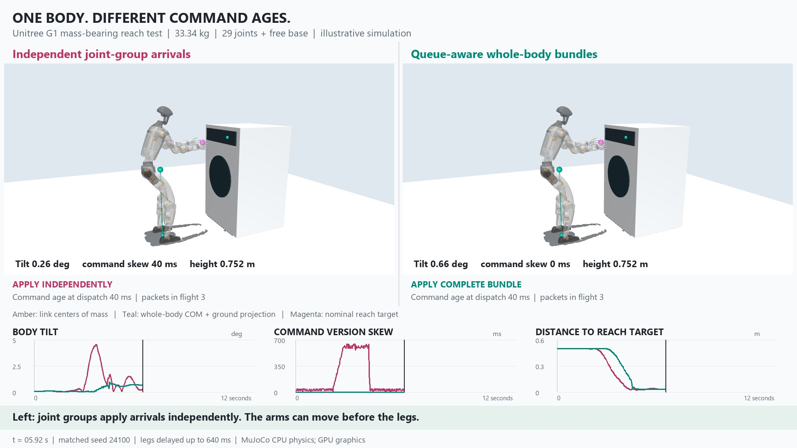

# Humanoid Laundry Queues

A standalone simulation-only research repository for mass-bearing humanoid movement under internal command delays. It does not modify or replace the separate Assured Autonomy or RAG repositories.

**An articulated rigid-body experiment, not a kinematic stick figure.** A free-base Unitree G1 reaches toward a fixed washing-machine proxy. Link masses, centers of mass, inertias, gravity, joint torque limits and foot contact are evaluated by MuJoCo. No force, weld, or script holds the pelvis in place during the experiment.

[](https://github.com/rbajaj5/humanoid-laundry-queues/releases/download/humanoid-queues-2026-10-24/humanoid_joint_queue_narrated.mp4)

[48-second MP4 with local automated narration and visible captions](https://github.com/rbajaj5/humanoid-laundry-queues/releases/download/humanoid-queues-2026-10-24/humanoid_joint_queue_narrated.mp4)

## Question and Mechanism

Can independently delayed components of a whole-body command disturb a humanoid even when each joint's local position servo works? Does preserving command-version coherence reduce that disturbance?

An offline nominal path bends the knees, shifts the hips, pitches the waist and extends both arms. Inverse kinematics constrains foot position, foot pitch and the mass-weighted horizontal center of mass. This constructs nominal static poses; it is not a dynamic balance certificate. The root position used in IK is **not** applied to the simulated robot. Only its 29 joint setpoints are actuated.

Commands travel in four groups: legs, waist, left arm and right arm. Both comparison arms have the same issued targets, force disturbances, packet schedule, local PD actuators, 20 ms setpoint lag, physics and initial state.

- **Independent arrivals:** apply the newest received version separately for each group. Discard stale arrivals.
- **Coherent bundles:** buffer received packets until a whole-body version is complete; apply the newest complete version atomically and discard obsolete versions. Keep the previous target until then. No future arrivals are consulted, in-flight packets are not magically canceled, and instantaneous joint motion is never imposed.

This is a queue-coherence supervisor, not a proven RTA safety filter. It cannot rescue arbitrary unstable configurations. Synchronization also delays the faster groups.

## Model and Protocol

- G1 model mass: **33.341142 kg**, 29 actuated joints plus a six-DOF floating base.
- Per-link mass, local COM and principal inertia: [link_inertias.csv](output/link_inertias.csv).
- Source: [MuJoCo Menagerie G1](https://github.com/google-deepmind/mujoco_menagerie/tree/f3b6013629c7b94f8ee93fd977b161fa8350f9bc/unitree_g1), pinned revision and file hashes in [model_manifest.json](output/model_manifest.json). BSD-3-Clause license is downloaded with the model; its meshes are not bundled in this repository.
- Physics: 2 ms MuJoCo CPU steps, 20 ms command updates, 1 s settling, then 12 s per episode. Graphics are separate; [render_backend.json](output/render_backend.json) identifies the actual renderer. This is **not GPU physics or neural-policy training**.
- Eight fixed seeds, four delay profiles, two arms: **64 episodes**, all retained in the results table. The movie shows the preselected seed 24100 in the 600 ms skew condition, not a selected worst case.
- Profiles: zero; uniform 200 ms; and leg delays of 200 or 600 ms with waist delay one quarter as large. Skew profiles add 0/20/40 ms per-group jitter. Larger delays occur during reach (2-4 s) and return (7-9 s). Other times retain jitter. These are synthetic stress profiles, not measured robot latencies.
- Falls: base height below 0.55 m or base tilt above 45 degrees at a 20 ms observation. Reach: at least 0.4 s total within 8 cm of the nominal right-hand endpoint during (4,7] s, and no fall over the episode. The metric is **not** a button press or washing-machine operation.
- Full configuration: [config.json](config.json). Seed variability covers small commanded-angle noise, horizontal force disturbances and delay jitter, not broad environments or independently trained policies.

## Results

Mean peak base tilt in degrees (sample standard deviation in parentheses):

| Delay profile | Independent arrivals | Coherent bundles | Falls / episodes, each arm |
| --- | ---: | ---: | ---: |
| Zero | 0.726 (0.013) | 0.726 (0.013) | 0 / 8 |
| Uniform 200 ms | 0.729 (0.032) | 0.729 (0.032) | 0 / 8 |
| Asymmetric 200 ms + jitter | 2.024 (0.085) | 0.724 (0.017) | 0 / 8 |
| Asymmetric 600 ms + jitter | 4.538 (0.051) | 0.959 (0.045) | 0 / 8 |

**Both methods succeed at reaching in all tested episodes.** The supported result is reduced posture disturbance under these asymmetric delays, not fall prevention or superior task completion. The zero/uniform conditions produce identical paired motion metrics, helping isolate inter-group mismatch. Coherent bundles have zero command-version skew by construction but still receive old information. The reaching trajectory is slower to begin than independent arrivals; first-reach time and dwell are recorded, not hidden.

For the 600 ms skew profile, mean first reach is 3.663 s with independent arrivals and 4.093 s with coherent bundles: about **0.43 s later** in exchange for less body tilt. These are small exploratory samples, not a proven optimum or hardware latency budget.

[Episode results](output/episode_results.csv) and [full summary](output/episode_results.json) include matched input hashes, thresholds, timings and compute provenance. [Baseline probe](output/baseline_probe.json) preserves a negative finding: the alternative lower-gain MJX model fell under simple static targets. The selected original G1 description has stiff position gains (kp=500, dampratio=1); transferring its behavior to hardware is not justified.

## What the Movie Shows

Actual simulated poses, not interpolated cartoon joint paths, are rendered at 1920x1080 and 25 fps. The 12-second episode is slowed by 2.5x, with an introduction and result card. Amber points expose major link COMs through translucent meshes; teal is whole-body COM and its ground projection; magenta is a nominal reaching target.

The synchronized plots show base tilt, command-version skew and right-hand target distance. The static projected foot-support margin in the CSV is a diagnostic only: it is not ZMP, capture point, or a proof of dynamic balance. Ground-contact force includes all floor contacts, not only feet.

Command age is measured at the command dispatch tick, 20 ms before the corresponding end-of-step pose sample. Command-version skew is the difference between the newest and oldest applied group versions, multiplied by 20 ms. Both ages refer to setpoint messages, not sensor age or a direct measurement of motor response lag.

Replay coverage is **2 full pose traces of 64 episodes**, one per arm for the preselected movie condition. Both full traces, frame-level CSVs and movie-to-simulation indices are retained. All 64 episodes can be deterministically regenerated; the tests exactly match the movie traces in the recorded environment. Cross-platform bitwise equality is not promised.

## Reproduce

From this experiment directory, use Python 3.11 and FFmpeg on PATH:

```powershell
python -m venv .venv
.\.venv\Scripts\python -m pip install -r requirements.txt
.\.venv\Scripts\python fetch_model.py
.\.venv\Scripts\python probe.py
.\.venv\Scripts\python simulate.py
.\.venv\Scripts\python -m unittest test_model -v
.\.venv\Scripts\python render.py
.\narrate.ps1 -Python .\.venv\Scripts\python.exe
```

Windows narration uses installed System.Speech voices, without an API. On other platforms the captioned silent MP4 is generated by `render.py`; narration is optional. Run `simulate.py --pilot` only for development: it writes a separately labeled pilot summary but regenerates the same selected replay. Model assets are about 20 MB and are fetched from the pinned upstream source with hash checks.

## Scope and Next Steps

The washer is a fixed collision box with visual details. No operable door, deformable clothing, grasping, contact-rich loading, button actuation, learned policy, sensor-delay estimator, torque-delay model, actuator thermal degradation or hardware test is included. This does not train an actuator or teach a humanoid to wash clothes. It tests one prerequisite: coordinated mass-bearing movement under internal setpoint-message delay.

Next tests should add a feedback whole-body balance controller with realistic gains, measured internal bus/actuator delays, packet loss and deadlines, payload variation, lower friction and disturbances. Eventually add articulated appliance parts, manipulation and actual learned policies. Do not infer safety merely from synchronized commands or COM projection.

The private class RAG helped frame scheduling latency and fallback limitations via [SOTER](https://arxiv.org/abs/1808.07921) and [Sinha et al.'s system-level OOD perspective](https://arxiv.org/abs/2212.14020). Neither source certifies this controller; no private paper corpus or retrieved excerpts are published here.
